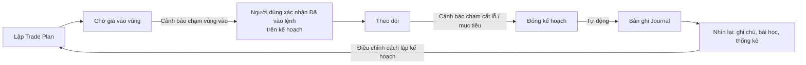
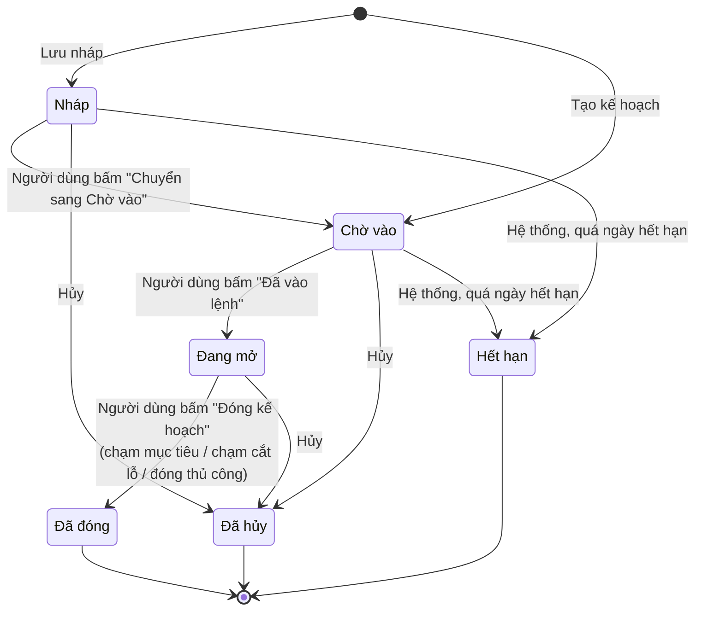

# Nghiệp vụ Trade Plan và Journal trong StockSense VN

Cập nhật: 03/11/2026. Tài liệu giải thích Trade Plan (kế hoạch giao dịch) và Journal (nhật ký giao dịch) dùng để làm gì, dùng như thế nào và web đang xử lý ra sao. Yêu cầu gốc ở PRD v0.0.4 (FR-M10, FR-M11, UC-17, UC-18); mức hoàn thành ở `tiendo.md`.

## 1. Bức tranh chung

Nhà đầu tư thua lỗ thường không phải vì chọn sai mã. Họ thua vì **không có kế hoạch trước khi mua** (mua theo cảm xúc, không biết khi nào bán) và **không nhìn lại sau khi bán** (lặp lại cùng một lỗi). Hai chức năng này giải quyết hai việc đó:

| | Trade Plan | Journal |
| --- | --- | --- |
| Câu hỏi trả lời | "Tôi sẽ mua ở đâu, sai thì cắt ở đâu, đúng thì chốt ở đâu, mua bao nhiêu?" | "Lần trước tôi làm gì, kết quả ra sao, rút ra được gì?" |
| Thời điểm | **Trước và trong** thời gian theo dõi một ý tưởng | **Sau** khi kết thúc ý tưởng đó |
| Ai nhập số liệu | Người dùng tự nhập mọi mức giá; hệ thống chỉ tính toán | Hệ thống tự ghi khi đóng kế hoạch; người dùng thêm ghi chú, bài học, thẻ |

Hai chức năng nối với nhau thành một vòng lặp kỷ luật:

**Quan trọng:** StockSense VN **chỉ mang tính tham khảo, không có chức năng mua bán**.
- Web không kết nối công ty chứng khoán, không đặt lệnh, không giữ tiền hay cổ phiếu của người dùng.
- Trade Plan là **kế hoạch trên giấy**: người dùng ghi lại ý tưởng và theo dõi nó với giá cuối ngày thật từ SSI.
- "Vào lệnh", "đóng", "lãi/lỗ" trong web đều là **theo kế hoạch**, không phải giao dịch thật. Nếu người dùng giao dịch thật thì làm ở nơi khác và tự chịu trách nhiệm.
- Mọi màn hình có câu tuyên bố "Trade Plan do bạn tự lập; hệ thống không đưa khuyến nghị đầu tư" (FR-M10-08).

## 2. Thuật ngữ cần nắm

| Thuật ngữ | Nghĩa | Ví dụ |
| --- | --- | --- |
| Vùng giá vào | Khoảng giá định mua, "từ … đến …" (có thể chỉ một giá) | 50.000 – 51.000 |
| Giá cắt lỗ (stop) | Mức giá mà nếu giảm tới thì chấp nhận bán lỗ, thừa nhận kế hoạch sai | 47.500 |
| Giá mục tiêu (target) | Mức giá dự kiến chốt lời | 57.000 |
| Rủi ro mỗi cổ phiếu | Giá vào − giá cắt lỗ | 51.000 − 47.500 = 3.500 |
| Lợi nhuận mỗi cổ phiếu | Giá mục tiêu − giá vào | 57.000 − 51.000 = 6.000 |
| **R:R** (lợi nhuận/rủi ro) | Lợi nhuận ÷ rủi ro; trên 2 được xem là tốt, dưới 1 là "rủi ro nhiều hơn lời" | 6.000 ÷ 3.500 ≈ **1,71** |
| **R** | Một đơn vị rủi ro. Kết quả đo bằng R cho phép so sánh các lệnh có giá khác nhau | Lời 7.000/cp khi rủi ro 3.500/cp = **+2R** |
| Rủi ro tối đa (% vốn) | Số tiền tối đa chấp nhận mất nếu chạm cắt lỗ, tính theo % vốn; thường 1–2% | 1% của 100 triệu = 1 triệu |
| Lô | HOSE/HNX giao dịch theo lô **100 cổ phiếu** | 285 cp → làm tròn xuống 200 cp |

## 3. Trade Plan

### 3.1 Dữ liệu của một kế hoạch

| Trường | Bắt buộc | Ghi chú |
| --- | --- | --- |
| Mã | Có | Mã đang được theo dõi trên web |
| Hướng | Có | Mua (long) hoặc Bán (short). Xem lưu ý ở mục 6 |
| Vùng vào từ … đến … | "Từ" bắt buộc | "Đến" phải ≥ "từ" |
| Cắt lỗ, mục tiêu | Có | Phải nằm đúng phía: với Mua thì cắt lỗ < vùng vào < mục tiêu |
| Khối lượng dự kiến | Không | Bỏ trống thì hệ thống điền khối lượng gợi ý (nếu có vốn và % rủi ro) |
| Vốn, % rủi ro tối đa | Không | Chỉ vai trò Nhà giao dịch và Chuyên viên phân tích; phải nhập cả hai hoặc bỏ cả hai. Có thể lấy từ hồ sơ đầu tư |
| Hết hạn | Không | Qua ngày này mà chưa vào lệnh thì kế hoạch tự hết hạn |
| Lý do | Không | Tối đa 1.000 ký tự; vì sao mua mã này. Rất quan trọng khi nhìn lại ở Journal |

Hệ thống **không bao giờ điền sẵn giá** (FR-M10-01). Người dùng phải tự quyết các mức giá, vì đây là kế hoạch của họ chứ không phải gợi ý của hệ thống.

### 3.2 Hệ thống tính gì (ví dụ đầy đủ)

Kế hoạch Mua FPT: vùng vào 50.000–51.000, cắt lỗ 47.500, mục tiêu 57.000, vốn 100 triệu, rủi ro tối đa 1%.

Để thận trọng, hệ thống tính theo **giá xấu nhất trong vùng vào**: với lệnh Mua đó là giá cao nhất (51.000).

| Chỉ số | Công thức | Kết quả |
| --- | --- | --- |
| Rủi ro/cp | 51.000 − 47.500 | 3.500 |
| Lợi nhuận/cp | 57.000 − 51.000 | 6.000 |
| R:R | 6.000 ÷ 3.500 | 1,71 |
| Khoảng cách tới cắt lỗ | 3.500 ÷ 51.000 | 6,86% |
| Khoảng cách tới mục tiêu | 6.000 ÷ 51.000 | 11,76% |
| Ngân sách rủi ro | 100.000.000 × 1% | 1.000.000 |
| Khối lượng theo rủi ro | 1.000.000 ÷ 3.500 | 285 cp |
| Khối lượng theo vốn | 100.000.000 ÷ 51.000 | 1.960 cp |
| **Khối lượng tối đa** | min(285; 1.960), làm tròn xuống lô 100 | **200 cp** |

Ý nghĩa: nếu mua 200 cp và giá chạm cắt lỗ, người dùng mất khoảng 700.000 đồng, tức dưới mức 1% vốn đã đặt ra. Đây là cốt lõi của "quản trị vốn": **khối lượng được suy ra từ rủi ro**, không phải từ cảm giác.

### 3.3 Trạng thái và ai chuyển trạng thái

| Trạng thái | Nghĩa nghiệp vụ |
| --- | --- |
| Nháp | Đang nghĩ, chưa theo dõi |
| Chờ vào | Đã chốt kế hoạch, chờ giá về vùng vào |
| Đang mở | Người dùng xác nhận kế hoạch **đã vào vùng mua** và bắt đầu theo dõi như đang nắm giữ |
| Đã đóng | Kết thúc kế hoạch. Lý do: chạm mục tiêu, chạm cắt lỗ hoặc đóng thủ công. Hệ thống tự tạo bản ghi Journal |
| Đã hủy | Bỏ kế hoạch. Không tạo Journal |
| Hết hạn | Hệ thống tự chuyển khi qua ngày hết hạn mà vẫn ở Nháp/Chờ vào, kèm thông báo. Trong CSDL lưu `status = cancelled`, `close_reason = expired` |

Nguyên tắc (FR-M10-05): **người dùng xác nhận mọi lần chuyển trạng thái; hệ thống chỉ gợi ý bằng cảnh báo**. Kế hoạch là quyết định của người dùng, nên hệ thống không tự chuyển sang "Đang mở" hay "Đã đóng" thay họ. Ngoại lệ duy nhất là Hết hạn.

### 3.4 Cảnh báo theo kế hoạch (FR-M10-06)

Sau phiên, lúc 15:30 ngày giao dịch, worker tải giá mới từ SSI rồi so phiên vừa xong (giá cao nhất, thấp nhất) với từng kế hoạch:

| Kế hoạch ở trạng thái | Điều kiện | Cảnh báo |
| --- | --- | --- |
| Chờ vào | Khoảng giá trong phiên chạm vùng vào | "FPT chạm vùng giá vào kế hoạch" |
| Đang mở (Mua) | Giá thấp nhất ≤ cắt lỗ | "FPT chạm giá cắt lỗ kế hoạch" |
| Đang mở (Mua) | Giá cao nhất ≥ mục tiêu | "FPT chạm giá mục tiêu kế hoạch" |
| Nháp/Chờ vào | Quá ngày hết hạn | "FPT: kế hoạch đã hết hạn" |

- Cảnh báo hiện ở chuông trên web. Nếu người dùng bật và đã xác minh kênh, cảnh báo còn được gửi qua email/Telegram.
- Mỗi loại cảnh báo chỉ gửi một lần cho mỗi phiên.
- Chỉ xét các phiên từ ngày lập kế hoạch trở đi.
- Đây là dữ liệu cuối ngày, không phải thời gian thực: cảnh báo đến sau phiên, không phải lúc giá đang chạm.

### 3.5 Sửa kế hoạch và lịch sử sửa (FR-M10-09)

- Sửa được khi kế hoạch còn Nháp, Chờ vào hoặc Đang mở.
- Các trường sửa được: vùng vào, cắt lỗ, mục tiêu, khối lượng, lý do, ngày hết hạn. Mã và hướng không sửa được.
- Mỗi lần sửa lưu một dòng trong `trade_plan_revisions` gồm thời điểm, giá trị cũ và giá trị mới. Trang kế hoạch hiện dòng thời gian các lần sửa.
- Ý nghĩa nghiệp vụ: lịch sử này cho thấy người dùng có **"dời cắt lỗ"** không. Dời cắt lỗ xuống để khỏi phải bán là lỗi kỷ luật phổ biến nhất, và Journal sẽ giữ lại bằng chứng đó.

### 3.6 Snapshot lúc lập (FR-M10-02)

- Khi tạo kế hoạch, hệ thống chụp lại bối cảnh lúc quyết định: giá thị trường, ngày giá, nguồn giá.
- Khi có mô hình AI, snapshot sẽ gồm thêm nhãn và xác suất dự báo T+2/T+5 cùng phiên bản mô hình.
- Snapshot **không sửa được**: trigger trong CSDL chặn mọi thay đổi, để sau này không ai "chỉnh lại lịch sử".

## 4. Journal

### 4.1 Hai loại bản ghi

| Loại | Tạo bởi | Khi nào | Nội dung |
| --- | --- | --- | --- |
| Đóng kế hoạch (`plan_close`) | Hệ thống, tự động | Ngay khi người dùng đóng một kế hoạch Đang mở | Tiêu đề "Đóng kế hoạch FPT · Chạm mục tiêu"; lãi/lỗ; R thực tế; kế hoạch gốc; mọi lần sửa; giá thoát; lý do đóng; snapshot lúc lập |
| Thủ công (`manual`) | Người dùng | Bất kỳ lúc nào, ví dụ ghi lại quyết định không mua, hoặc giao dịch không có kế hoạch | Mã, ngày quyết định, tiêu đề, ghi chú, bài học, thẻ |

- Mỗi kế hoạch chỉ sinh **đúng một** bản ghi Journal (`plan_id` là duy nhất), nên đóng lại lần hai không tạo trùng.
- Kế hoạch bị hủy hoặc hết hạn không sinh bản ghi.

### 4.2 Cái gì sửa được, cái gì không (FR-M11-02)

| Sửa được | Không sửa được (CSDL chặn bằng trigger) |
| --- | --- |
| Ghi chú, Bài học, Thẻ (ví dụ "kỷ luật", "fomo", "breakout") | Mã, loại bản ghi, tiêu đề, lãi/lỗ, snapshot (kế hoạch gốc, lịch sử sửa, giá thoát) |

Lý do: nhật ký chỉ có giá trị khi **kết quả là thật**. Người dùng được viết thêm suy nghĩ, nhưng không được sửa lỗ thành lãi.

### 4.3 Ví dụ một bản ghi tự động

Tiếp ví dụ FPT ở mục 3.2: người dùng xác nhận vào lệnh với 200 cp theo kế hoạch, sau đó giá chạm 57.000 và có cảnh báo. Người dùng đóng kế hoạch ở giá thoát 56.000 với lý do "Chạm mục tiêu".

| Mục | Giá trị |
| --- | --- |
| Lãi/lỗ | (56.000 − 50.000) × 200 = **+1.200.000 đ** |
| R thực tế | (56.000 − 50.000) ÷ (50.000 − 47.500) = **+2,4R** |
| Kế hoạch gốc | Vùng vào 50.000–51.000, cắt lỗ 47.500, mục tiêu 57.000, lý do ban đầu |
| Lịch sử sửa | Ví dụ "Cắt lỗ 47.500 → 48.500 ngày 05/11" |

Lãi/lỗ và R là **theo kế hoạch**, tính từ giá "vào từ" (50.000) và giá thoát người dùng nhập. Đây không phải lãi/lỗ của giao dịch thật, nên không có phí, thuế hay giá khớp.

Sau đó người dùng viết Bài học, ví dụ "Bán sớm hơn mục tiêu 1.000 vì sợ giảm, vẫn đạt 2,4R", và gắn thẻ "kỷ luật".

### 4.4 Lọc, thống kê, xuất báo cáo

- **Lọc** (FR-M11-05) theo mã, khoảng ngày, thẻ, kết quả (lãi/lỗ/hòa/chưa có), và tìm từ khóa trong tiêu đề, ghi chú, bài học.
- **Thống kê nhìn lại** (FR-M11-06) theo tuần, tháng hoặc quý, tính trên các kế hoạch đã đóng:
  - số kế hoạch;
  - tỷ lệ chạm mục tiêu và tỷ lệ chạm cắt lỗ;
  - số lệnh lãi/lỗ;
  - **R thực tế trung bình** so với **R kế hoạch trung bình** (R kế hoạch là R:R lúc lập);
  - tổng lãi/lỗ.
- **Đọc thống kê:** nếu R thực tế thấp hơn hẳn R kế hoạch, người dùng đang chốt lời quá sớm hoặc cắt lỗ quá muộn. Tỷ lệ thắng thấp vẫn có thể có lãi nếu R thực tế trung bình cao.
- **Xuất PDF** Journal theo khoảng ngày đang lọc.

## 5. Phân quyền

| Chức năng | Nhà đầu tư cá nhân | Nhà giao dịch | Chuyên viên phân tích | Quản trị |
| --- | --- | --- | --- | --- |
| Lập, sửa, đóng Trade Plan; tính R:R | ✓ | ✓ | ✓ | |
| Tính khối lượng theo vốn và % rủi ro | | ✓ | ✓ | |
| Xuất PDF kế hoạch | ✓ | ✓ | ✓ | |
| Xem Journal, sửa ghi chú/bài học/thẻ | ✓ | ✓ | ✓ | |
| Ghi Journal thủ công, thống kê nhìn lại, xuất PDF Journal | | ✓ | ✓ | |

- Mọi dữ liệu là **riêng từng tài khoản** (FR-M11-07). Người dùng khác và cả Quản trị đều không xem được kế hoạch hay nhật ký của người khác.
- Nhà đầu tư cá nhân dùng bản rút gọn để giao diện đơn giản.

## 6. Điểm cần lưu ý và cần nhóm thống nhất

Web chỉ mang tính tham khảo, nên lãi/lỗ là **theo kế hoạch**: không tính phí, thuế, giá khớp hay chu kỳ thanh toán, và không cần nối với giao dịch thật. Tuy vậy, kế hoạch vẫn nên **hợp lý với thị trường Việt Nam** để việc nhìn lại có ý nghĩa. Các điểm dưới đây cần nhóm quyết định trước khi sửa code.

1. **Hướng "Bán" (short).**
   - Hiện tại: web cho lập kế hoạch Bán, tức kỳ vọng kiếm lời khi giá giảm.
   - Thực tế: thị trường cơ sở Việt Nam **chưa cho nhà đầu tư cá nhân bán khống cổ phiếu**, nên kế hoạch kiểu này không phản ánh được điều người dùng có thể làm.
   - Đề xuất: bỏ lựa chọn Bán, chỉ giữ kế hoạch Mua.
2. **Bước giá.**
   - Hiện tại: giá vào, cắt lỗ, mục tiêu nhập tự do, ví dụ 50.123 vẫn được nhận.
   - Đề xuất: kiểm tra giá theo bước giá của sàn (HOSE: 10/50/100 đồng tùy mức giá; HNX/UPCoM: 100 đồng). Web đã có sẵn hàm `tickSize` dùng cho bảng giá.
3. **Dữ liệu cuối ngày.**
   - Cảnh báo chỉ đến sau 15:30, dựa trên giá cao/thấp của cả phiên.
   - Cần ghi rõ trên trang Trade Plan rằng đây là **nhắc theo dõi**, không phải lệnh dừng lỗ hay chốt lời tự động.
4. **Lãi/lỗ "theo kế hoạch".**
   - Màn hình và PDF đang ghi là "Lãi/lỗ".
   - Đề xuất: đổi nhãn thành "Lãi/lỗ theo kế hoạch" để người dùng không hiểu nhầm là tiền thật.

## 7. Phần sẽ có khi có mô hình AI

| Yêu cầu | Khi có mô hình |
| --- | --- |
| FR-M10-02 | Snapshot lúc lập có nhãn và xác suất T+2/T+5, phiên bản mô hình |
| FR-M10-06 | Cảnh báo "nhãn dự báo mới ngược với kế hoạch", ví dụ đang mở Mua mà T+5 chuyển sang Giảm |
| FR-M11-01, 03 | Journal cho biết lúc quyết định người dùng **làm theo hay ngược tín hiệu**, kèm nhãn thực tế T+2/T+5 |
| FR-M11-04 | Bản ghi thủ công tự gắn dự báo của ngày quyết định |
| FR-M11-06 | Thống kê thêm "tỷ lệ làm theo tín hiệu" và kết quả của hai nhóm |

## 8. Vị trí trong code

| Phần | File |
| --- | --- |
| Bảng, ràng buộc, trigger chặn sửa | `db/migrations/008_trade_plans_journal.sql`, `009_journal_fields.sql`, `020_non_ai_completion.sql` |
| Tính R:R và khối lượng theo lô | `packages/core/src/calc/riskReward.js` |
| Trạng thái, sửa, đóng → Journal | `apps/api/src/plans/repository.js` |
| Journal: lọc, thống kê, sửa | `apps/api/src/journal/repository.js` |
| Cảnh báo chạm mốc, hết hạn | `apps/worker/src/jobs/price-alerts.js` |
| Giao diện | `apps/web/src/features/plans/PlansPage.jsx`, `apps/web/src/features/journal/JournalPage.jsx` |
